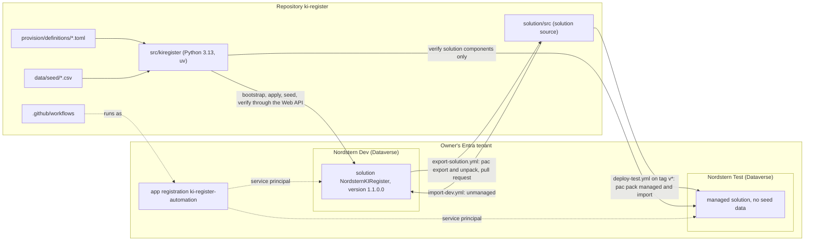

# Nordstern KI-Register

[](https://github.com/HARISPAARTAN/ki-register/actions/workflows/ci.yml)

Deutsch: [README.md](README.md)

A register of AI systems under the EU AI Act (Regulation (EU) 2024/1689; "KI" is the German abbreviation for AI) for the fictional Nordstern group with three subsidiaries, built on Microsoft Dataverse and provisioned entirely as code: tables, choices, relationships, security roles, views, forms, charts, dashboard and the model-driven app are created from TOML definitions through the Dataverse Web API. The exported solution source lives in the repository; GitHub Actions export it from Dev and deliver it as a managed solution to Test. **This project is not legal advice.** All data is invented.

Legal state of the classifications: Regulation (EU) 2024/1689 as amended by Regulation (EU) 2026/1744, as of 2026-10-25; not legal advice.

**Status: milestone 1 (register core).** Repository version 0.1.0, solution `NordsternKIRegister` 1.1.0.0. Still to come: milestone 2 (intake app and approval flow), 3 (agent), 4 (governance and showcase).

## Architecture



The TOML files are the source of truth; `solution/src` is the export from them plus the additions that can only be set through a solution import (ADR-002, ADR-003). The data model is in [docs/erd.md](docs/erd.md) (German).

```
provision/definitions/   TOML: choices, tables, relationships, security, app
src/kiregister/          Python package: Web API client, builders, apply, seed, verify, CLI
data/seed/               the fictional register as CSV
solution/src/            exported solution source (pac solution unpack)
tools/                   erd.py (writes docs/erd.md), setup_app_registration.sh
docs/                    ERD, decision records, rebuild guide, changelog (German)
tests/                   unit tests (offline) and integration tests (marker dataverse)
.github/workflows/       ci, export-solution, import-dev, deploy-test
```

## The four commands

Run as `uv run --env-file .env kiregister <command> --env dev` (or `--env test`). The `.env` is git-ignored (template: `.env.example`) and never goes into a chat or the repository.

| Command | Effect |
|---|---|
| `bootstrap` | creates the application user of the service principal with the System Administrator role (once per environment, using the owner's Azure CLI session after `az login`) |
| `apply [--only metadata\|security\|app]` | creates or updates, never deletes. `metadata`: publisher, solution (sets its version), choices, tables, columns, relationships. `security`: business units, one member-less owner team per unit, four roles with privileges, the column security profile. `app`: views, forms, charts, dashboard, site map, the app `KI-Register` and the roles that may open it. A second run changes nothing |
| `seed [--stichtag YYYY-MM-DD]` | loads the fictional register with fixed GUIDs. All dates are relative to the reference date (default: today, UTC) and shifted by whole weeks so that "overdue" stays true. Creates no units or teams: run `apply --only security` first |
| `verify` | checks tables, columns, lookups, choices, relationships, roles, the column security profile, the app module with its table components, business units, owner teams (they must be empty and the role `nst Datenbesitz` must not belong to a user) and the seed counts; exit code 1 on any deviation. With `KIREGISTER_VERIFY_NO_SEED=1` it checks solution components only, which is how `deploy-test.yml` checks the test environment |

## Building an environment

Prerequisites: an environment with a Dataverse database, `az login`, the app registration (`bash tools/setup_app_registration.sh` prints tenant ID, client ID and the secret once) and the five secrets in the `.env` and in GitHub (see ALM).

**Order for a fresh environment** (derived from the design, not yet exercised on a fresh environment):

1. `bootstrap`: create the application user.
2. **Import the solution from the source** (`gh workflow run import-dev.yml` or in the portal, [rebuild guide](docs/nachbau-anleitung.md), German). The import brings tables, columns, relationships, roles, the column security profile, views, forms, charts, dashboard, site map and the app together with its table components and roles.
3. `apply --only security`: business units and owner teams (they are not part of the solution).
4. `seed`.
5. `verify`.

A full `apply` (metadata, security, app) before the import is the code-first development path: that is how Dev came about, followed by one import that makes the tables components of the app (`AddAppComponents` cannot do that on this environment, ADR-002). Next to an import, a full `apply` would probably create views and forms twice, because their IDs differ per environment.

The import is also a precondition of the checks that require the table components of the app: `verify` and `tests/integration/test_app.py`. If Dev holds changes that are not in the repository yet, run `export-solution.yml` first (the import overwrites, `force-overwrite`).

The code does not switch on auditing for the environment itself (admin center, settings, audit and logs); the tables KI-System, Risikobewertung and Anwendungsfall already carry the audit flag (ADR-002).

## ALM: workflows and secrets

`pac` runs on GitHub runners only, never on the owner's machine. Every third-party action is pinned to a commit SHA (the tag is a comment in the workflow; for `microsoft/powerplatform-actions` it is the state the tag `v1` had on 2026-10-25), and `.github/dependabot.yml` proposes updates. Rationale, deadlines and licensing, and why neither pipelines nor Git integration: [ADR-003](docs/decisions/ADR-003-alm-ohne-pipelines.md) (German).

| Workflow | Trigger | Effect |
|---|---|---|
| `ci.yml` | push to `main`; pull requests that do not only change `solution/**` (the filter held for the first export, ADR-003); the `integration` job is manual only | Ruff and unit tests; by hand also the integration tests (`-m dataverse`) against Dev, with the secrets in the test step only |
| `export-solution.yml` | manual | exports `NordsternKIRegister` from Dev (unmanaged and managed), unpacks it to `solution/src` and opens a pull request that may contain files under `solution/src` only; the diff is reviewed and the pull request merged |
| `import-dev.yml` | manual | packs `solution/src` as unmanaged and imports it into Dev. Runs with `force-overwrite`: if Dev holds changes that are not in the repository yet, run `export-solution.yml` first |
| `deploy-test.yml` | tag `v*` or manual | packs `solution/src` as managed, imports it into Test and runs `kiregister verify --env test` with `KIREGISTER_VERIFY_NO_SEED=1` |

Test receives the solution only: business units, owner teams and seed data are not solution components. A workflow starts from Actions, "Run workflow", or with `gh workflow run <file>`; a human pushes tags.

The owner enters the five secrets in the repository settings (Settings, Secrets and variables, Actions) and, for local use, in the `.env`:

| Secret | Content | Used by |
|---|---|---|
| `TENANT_ID` | tenant ID | every workflow that reaches Dataverse |
| `CLIENT_ID` | application ID of the app registration `ki-register-automation` | every workflow that reaches Dataverse |
| `CLIENT_SECRET` | client secret of the app registration | every workflow that reaches Dataverse |
| `DATAVERSE_URL_DEV` | URL of Nordstern Dev | `export-solution.yml`, `import-dev.yml`, job `integration` |
| `DATAVERSE_URL_TEST` | URL of Nordstern Test | `deploy-test.yml` |

## Role model

Three business units (children of the root) are the access boundaries: `Nordstern Projektmanagement`, `Nordstern Energie`, `Nordstern Klinikum`. All tables are user- or team-owned. The records of a subsidiary belong to its member-less owner team `<unit> Datenbesitz`, and the role `nst Datenbesitz` (read only) gives that team the read privilege it needs; a user with a unit-level role therefore sees only the records of their own unit (ADR-002).

| Role | Access |
|---|---|
| `nst KI-Governance` | create, read, write, delete, append, append to, assign and share on all `nst_` tables for the whole organisation; read on user, team and business unit; the only role in the column security profile `nst KI-Governance Felder` (secured column: the internal assessment of an AI system) |
| `nst Fachbereich` | read at unit level: KI-System, Maßnahme, Schulung, Schulungsteilnahme, Mitarbeiter, Organisation; Anwendungsfall: create, read, write, append for own records only; no Risikobewertung. The seeded Anwendungsfälle belong to the owner team and are invisible to this role |
| `nst Leser` | read at unit level on all `nst_` tables except Risikobewertung; no secured column |
| `nst Datenbesitz` | read only, for the owner teams only; never assigned to a user, `verify` reports any assignment |

The three user roles may open the app `KI-Register` (`provision/definitions/app.toml`), `nst Datenbesitz` may not. Assigning roles and the profile to users is a portal step (ADR-002); column security does not apply to system administrators, so only an account without that role shows the masked display (ADR-001).

## The register

The fictional register holds three subsidiaries, 21 employees, 20 AI systems, 27 risk assessments, 42 measures, 9 trainings with 51 participations and 7 use-case requests. All names are invented, the e-mail domain is `nordstern.example`.

| Subsidiary | Systems | Unacceptable | High | Limited | Minimal |
|---|---|---|---|---|---|
| Nordstern Projektmanagement GmbH (Hamburg) | 7 | 1 | 1 | 1 | 4 |
| Nordstern Energie GmbH (Kiel) | 7 | 0 | 2 | 1 | 4 |
| Nordstern Klinikum gGmbH (Lübeck) | 6 | 0 | 2 | 1 | 3 |
| **Total** | **20** | **1** | **5** | **3** | **11** |

| Subsidiary | System | Tier | Note |
|---|---|---|---|
| Projektmanagement | TalentFilter Bewerbungs-Screening | High | Annex III point 4, bought in, deployer; review overdue |
| Projektmanagement | Baustellen-Mängelerkennung | Minimal | in-house, no Annex III area |
| Projektmanagement | Kunden-Chatbot Website | Limited | transparency under Art. 50; review overdue |
| Projektmanagement | Angebotstext-Generator | Minimal | use of a GPAI system; Art. 50 note for generated text |
| Projektmanagement | Terminrisiko-Prognose | Minimal | |
| Projektmanagement | Microsoft 365 Copilot | Minimal | GPAI in use; training under Art. 4 |
| Projektmanagement | Emotionserkennung Baustellenpersonal | Unacceptable | Art. 5(1)(f); status Abgelehnt (rejected) |
| Energie | Netzlast-Prognose zur Verteilnetzsteuerung | High | Annex III point 2; national registration instead of the EU database |
| Energie | Zahlungsausfall-Scoring Neukunden | High | Annex III point 5(b) |
| Energie | Störungsmeldungs-Chatbot | Limited | transparency under Art. 50 |
| Energie | Zählerstand-Bilderkennung | Minimal | review overdue |
| Energie | Predictive Maintenance Trafostationen | Minimal | no safety component (reasoning in the register) |
| Energie | Biometrische Zutrittskontrolle Umspannwerk | Minimal | 1:1 verification is no remote identification |
| Energie | Microsoft 365 Copilot | Minimal | training under Art. 4 |
| Klinikum | Radiologie-Befundunterstützung | High | via Annex I (medical device, class IIa) |
| Klinikum | Notaufnahme-Triage-Priorisierung | High | Annex III point 5(d); status In Bewertung (under assessment) |
| Klinikum | Bettenbelegungs-Prognose | Minimal | status Freigegeben (approved) |
| Klinikum | Patienten-Chatbot Terminvergabe | Limited | transparency under Art. 50 |
| Klinikum | Diktat-LLM für Arztbriefe | Minimal | data-protection measures; review overdue |
| Klinikum | Dienstplan-Optimierung Pflege | Minimal | no decisions on traits or performance |

The view "Hochrisiko-Systeme" shows the tier High (5 systems); the prohibited system (Art. 5) is not a high-risk system. Four systems in operation always have an overdue review (the dates are relative to the reference date). The column `nst_eudatenbank` means: registration in the EU database under Art. 49 is required. The keys of the seed files are opaque identifiers and are never renamed (ADR-002).

## Screenshots (placeholders)

The screenshots are still to be taken. **Take all screenshots and the video before 2026-12-15:** after that date Dev and Test are suspended (see below). File names under `docs/screenshots/`:

| File | Content |
|---|---|
| `01-ansicht-aktive-ki-systeme.png` | app `KI-Register`, area Register, view "Aktive KI-Systeme" |
| `02-ansicht-hochrisiko.png` | view "Hochrisiko-Systeme" (5 rows) |
| `03-ansicht-pruefung-ueberfaellig.png` | view "Prüfung überfällig" (4 rows) |
| `04-formular-einstufung.png` | main form of an AI system, tab Einstufung |
| `05-formular-gesichertes-feld.png` | tab Intern with the secured column, once as a governance user (readable), once as a user without the System Administrator role and without the profile (masked) |
| `06-dashboard.png` | dashboard "KI-Register Übersicht" with the three charts and the list |
| `07-unternehmenseinheiten.png` | admin center: the root and the three business units, plus the owner teams |
| `08-rolle-ki-governance.png` | security role `nst KI-Governance`: privileges and access levels |
| `09-spaltensicherheitsprofil.png` | profile `nst KI-Governance Felder` with the permission for the internal assessment |
| `10-loesung-und-verlauf.png` | maker portal: solution `NordsternKIRegister` with components and solution history |
| `11-actions-export-und-deploy.png` | GitHub Actions: green CI run, export pull request, deployment to Test |
| `12-test-verwaltete-loesung.png` | Nordstern Test: the imported managed solution |

## Environment deadline and rebuild

Nordstern Dev and Nordstern Test are free developer environments from the Developer Plan. Microsoft is retiring unmanaged developer environments: no new ones from 2026-11-15, **suspension from 2026-12-15, deletion from 2027-01-15**, unless the environments become managed environments. That requires premium licences, which this project does not plan for. Sources (Microsoft Learn) and the assumption about the environment type, which was not read from the admin center: [ADR-003](docs/decisions/ADR-003-alm-ohne-pipelines.md). All milestones therefore end before 2026-12-10, and everything that can be rebuilt is in the repository.

**Rebuild in a trial environment** (a standard trial environment with 30 days, still available according to Microsoft Learn): the same order as above, with `DATAVERSE_URL_DEV` pointing at the new environment: `bootstrap`, import, `apply --only security`, `seed`, `verify`; the steps are in the [rebuild guide](docs/nachbau-anleitung.md) (German). This order is derived and has not yet been exercised on a fresh environment.

## Tests

- Unit tests run offline (HTTP mocked with `respx`): `uv run pytest tests/unit -q`, plus `uv run ruff check .`. Both run in `ci.yml` on every push to `main` and on pull requests.
- Integration tests (marker `dataverse`) run against Nordstern Dev and skip themselves without `DATAVERSE_URL_DEV`: `uv run --env-file .env pytest tests/integration -m dataverse -v`. They need the solution import (see above).
- `docs/erd.md` is written by `tools/erd.py` (`uv run python tools/erd.py`); a unit test fails if the file differs from what the definitions produce.

## Documentation

All documents except this README are in German.

- [Data model (ERD)](docs/erd.md)
- [ADR-001 Dataverse instead of SharePoint lists](docs/decisions/ADR-001-dataverse-statt-sharepoint.md)
- [ADR-002 Code-first provisioning](docs/decisions/ADR-002-code-first-provisionierung.md)
- [ADR-003 ALM without pipelines](docs/decisions/ADR-003-alm-ohne-pipelines.md)
- [Rebuild guide](docs/nachbau-anleitung.md)
- [Changelog](docs/CHANGELOG.md)

## Licence and data

MIT licence (see `LICENSE`). All data is invented: subsidiaries, employees, e-mail addresses (domain `nordstern.example`) and systems have no relation to real people or companies. Product names such as Microsoft 365 Copilot appear in the register as examples of AI systems in companies. The classifications are examples and **not legal advice**.
