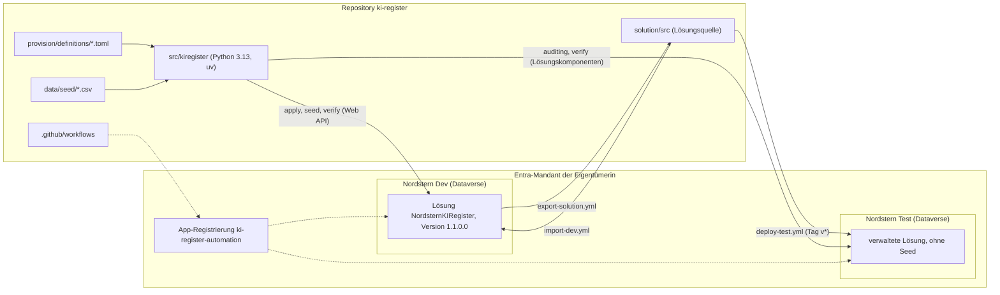

# Nordstern KI-Register

[](https://github.com/HARISPAARTAN/ki-register/actions/workflows/ci.yml)

English: [README.en.md](README.en.md)

Ein Register für KI-Systeme nach der EU-KI-Verordnung (Verordnung (EU) 2024/1689, „EU AI Act“) für die fiktive Nordstern Gruppe mit drei Gesellschaften, gebaut auf Microsoft Dataverse und vollständig als Code provisioniert: Tabellen, Auswahlfelder, Beziehungen, Sicherheitsrollen, Ansichten, Formulare, Diagramme, Dashboard und die modellgesteuerte App entstehen aus TOML-Definitionen über die Dataverse Web API. Die exportierte Lösungsquelle liegt im Repository; GitHub Actions exportieren sie aus Dev und liefern sie als verwaltete Lösung nach Test. **Dieses Projekt ist keine Rechtsberatung.** Alle Daten sind erfunden.

Rechtsstand der Einstufungen: Verordnung (EU) 2024/1689 in der Fassung der Verordnung (EU) 2026/1744, Stand 2026-10-25; keine Rechtsberatung.

**Status: Meilenstein 1 (Registerkern).** Repository-Version 0.1.0, Lösung `NordsternKIRegister` 1.1.0.0. Folgen: Meilenstein 2 (Erfassungs-App und Genehmigungsfluss), 3 (Agent), 4 (Governance und Schaufenster).

## Architektur



Die TOML-Dateien sind die Quelle der Wahrheit; `solution/src` ist der Export daraus plus die Ergänzungen, die sich nur über den Lösungsimport setzen lassen (ADR-002, ADR-003). Das Datenmodell steht in [docs/erd.md](docs/erd.md).

```
provision/definitions/   TOML: Auswahlfelder, Tabellen, Beziehungen, Sicherheit, App
src/kiregister/          Python-Paket: Web-API-Client, Builder, apply, seed, verify, CLI
data/seed/               das fiktive Register als CSV
solution/src/            exportierte Lösungsquelle (pac solution unpack)
tools/                   erd.py (erzeugt docs/erd.md), setup_app_registration.sh
docs/                    ERD, Entscheidungen, Wiederaufbau-Anleitung, Änderungsprotokoll
tests/                   Unit-Tests (offline) und Integrationstests (Marker dataverse)
.github/workflows/       ci, export-solution, import-dev, deploy-test
```

## Die vier Befehle

Aufruf: `uv run --env-file .env kiregister <Befehl> --env dev` (oder `--env test`). Die `.env` ist git-ignoriert (Vorlage: `.env.example`) und gehört nie in einen Chat oder ins Repository.

| Befehl | Wirkung |
|---|---|
| `bootstrap` | legt den Anwendungsbenutzer des Dienstprinzipals mit der Rolle System Administrator an (einmal je Umgebung, mit der Azure-CLI-Sitzung der Eigentümerin oder des Eigentümers nach `az login`) |
| `apply [--only metadata\|security\|app\|auditing]` | legt an oder aktualisiert, löscht nie. `metadata`: Herausgeber, Lösung (setzt deren Version), Auswahlfelder, Tabellen, Spalten, Beziehungen. `security`: Unternehmenseinheiten, je Einheit ein mitgliederloses Besitzerteam, vier Rollen mit Privilegien, Spaltensicherheitsprofil. `app`: Ansichten, Formulare, Diagramme, Dashboard, Sitemap, die App `KI-Register` und die Rollen, die sie öffnen dürfen. `auditing`: schaltet das Auditing der Umgebung ein (die Organisationseinstellung `isauditenabled`, keine Lösungskomponente); das volle `apply` tut das als letzten Schritt, und `apply --only auditing` ist die einzige Variante, die gegen Test läuft. Ein zweiter Lauf ändert nichts |
| `seed [--stichtag YYYY-MM-DD]` | lädt das fiktive Register mit festen GUIDs. Alle Datumswerte sind relativ zum Stichtag (Standard: heute, UTC) und werden um ganze Wochen verschoben, damit „überfällig“ wahr bleibt. Legt keine Einheiten oder Teams an: vorher `apply --only security` |
| `verify` | prüft Tabellen, Spalten, Nachschlagefelder, Auswahlfelder, Beziehungen, Rollen, das Spaltensicherheitsprofil, das App-Modul samt Tabellenkomponenten, den Schalter für das Auditing der Umgebung, Unternehmenseinheiten, Besitzerteams (leer; die Rolle `nst Datenbesitz` darf keinem Benutzer gehören) und die Seed-Anzahlen; Exit-Code 1 bei Abweichung. Mit `KIREGISTER_VERIFY_NO_SEED=1` nur die Lösungskomponenten und den Schalter für das Auditing: so prüft `deploy-test.yml` die Testumgebung |

## Eine Umgebung aufbauen

Voraussetzungen: eine Umgebung mit Dataverse-Datenbank, `az login`, die App-Registrierung (`bash tools/setup_app_registration.sh` gibt Mandanten-ID und Client-ID aus, das Geheimnis einmalig und nur bei einer neuen Registrierung oder mit `RESET_SECRET=1`, was alle vorhandenen Geheimnisse der App ersetzt) und die fünf Geheimnisse in der `.env` und in GitHub (siehe ALM).

**Reihenfolge für eine frische Umgebung** (aus dem Entwurf abgeleitet, auf einer frischen Umgebung noch nicht durchgespielt):

1. `bootstrap`: Anwendungsbenutzer anlegen.
2. **Lösung aus dem Quelltext importieren** (`gh workflow run import-dev.yml`, der einzige Importweg; [Wiederaufbau-Anleitung](docs/nachbau-anleitung.md)). Der Import bringt Tabellen, Spalten, Beziehungen, Rollen, Spaltensicherheitsprofil, Ansichten, Formulare, Diagramme, Dashboard, Sitemap und die App samt Tabellenkomponenten und Rollen mit.
3. `apply --only security`: Unternehmenseinheiten und Besitzerteams (sie gehören nicht zur Lösung).
4. `apply --only auditing`: das Auditing der Umgebung einschalten (eine Organisationseinstellung, auch sie gehört nicht zur Lösung).
5. `seed`.
6. `verify`.

Das volle `apply` (Metadaten, Sicherheit, App, Auditing) vor dem Import ist der Weg der Code-first-Entwicklung: So ist Dev entstanden, danach kam einmal der Import, der die Tabellen zu Komponenten der App macht (`AddAppComponents` kann das auf dieser Umgebung nicht, ADR-002). Neben einem Import würde ein volles `apply` voraussichtlich Ansichten und Formulare doppelt anlegen, weil deren IDs je Umgebung verschieden sind.

Der Import ist auch Voraussetzung der Prüfungen, die die Tabellenkomponenten der App verlangen: `verify` und `tests/integration/test_app.py`. Hat Dev Änderungen, die noch nicht im Repository stehen, läuft vorher `export-solution.yml` (der Import überschreibt, `force-overwrite`).

Das Auditing der Umgebung ist seit 2026-10-26 in Dev und Test eingeschaltet, mit `kiregister apply --only auditing` (die Organisationseinstellung `isauditenabled`; sie gehört nicht zur Lösung, ADR-002, ADR-003). Die Tabellen KI-System, Risikobewertung und Anwendungsfall tragen den Audit-Flag (`IsAuditEnabled`); Dataverse schreibt ein Protokoll nur, solange auch der Schalter der Umgebung an ist.

## ALM: Workflows und Geheimnisse

`pac` läuft nur auf GitHub-Runnern, nie auf dem Arbeitsrechner. Alle Aktionen von Dritten sind auf einen Commit-SHA festgelegt (der Tag steht als Kommentar im Workflow; für `microsoft/powerplatform-actions` ist es der Stand, den der Tag `v1` am 2026-10-25 hatte), und `.github/dependabot.yml` schlägt Änderungen vor. Begründung, Fristen und Lizenzlage, warum keine Pipelines und keine Git-Integration: [ADR-003](docs/decisions/ADR-003-alm-ohne-pipelines.md).

| Workflow | Auslöser | Wirkung |
|---|---|---|
| `ci.yml` | Push auf `main`; Pull Requests, die nicht nur `solution/**` ändern (der Filter hat beim ersten Export gehalten, ADR-003); der Job `integration` nur von Hand | Ruff und Unit-Tests; von Hand zusätzlich die Integrationstests (`-m dataverse`) gegen Dev, mit den Geheimnissen nur im Testschritt |
| `export-solution.yml` | von Hand | exportiert `NordsternKIRegister` aus Dev (unmanaged und managed), entpackt nach `solution/src` und öffnet einen Pull Request, der nur Dateien unter `solution/src` enthalten darf; der Diff wird geprüft und der Pull Request zusammengeführt |
| `import-dev.yml` | von Hand | packt `solution/src` als unmanaged und importiert nach Dev. Läuft mit `force-overwrite`: Hat Dev Änderungen, die noch nicht im Repository stehen, zuerst `export-solution.yml` ausführen |
| `deploy-test.yml` | Tag `v*` oder von Hand | packt `solution/src` als managed, importiert nach Test und führt `kiregister verify --env test` mit `KIREGISTER_VERIFY_NO_SEED=1` aus |

Test erhält nur die Lösung: Unternehmenseinheiten, Besitzerteams und Seed-Daten sind keine Lösungskomponenten. Die einzige Ausnahme ist der Schalter für das Auditing der Umgebung, den `apply --env test --only auditing` setzt (es berührt nur die Organisationseinstellung, ADR-003); `verify` verlangt ihn auch in Test. Einen Workflow startet man über Actions, „Run workflow“, oder mit `gh workflow run <Datei>`; Tags setzt der Mensch.

Die fünf Geheimnisse trägt die Eigentümerin in die Repository-Einstellungen ein (Settings, Secrets and variables, Actions) und, für den lokalen Betrieb, in die `.env`:

| Geheimnis | Inhalt | Verwendet von |
|---|---|---|
| `TENANT_ID` | Mandanten-ID | alle Workflows mit Zugriff auf Dataverse |
| `CLIENT_ID` | Anwendungs-ID der App-Registrierung `ki-register-automation` | alle Workflows mit Zugriff auf Dataverse |
| `CLIENT_SECRET` | Client-Geheimnis der App-Registrierung | alle Workflows mit Zugriff auf Dataverse |
| `DATAVERSE_URL_DEV` | URL von Nordstern Dev | `export-solution.yml`, `import-dev.yml`, Job `integration` |
| `DATAVERSE_URL_TEST` | URL von Nordstern Test | `deploy-test.yml` |

## Rollenmodell

Drei Unternehmenseinheiten (Kinder der Wurzel) sind die Zugriffsgrenzen: `Nordstern Projektmanagement`, `Nordstern Energie`, `Nordstern Klinikum`. Alle Tabellen sind benutzer- oder teameigen. Die Datensätze einer Gesellschaft gehören dem mitgliederlosen Besitzerteam `<Einheit> Datenbesitz`, dem die Rolle `nst Datenbesitz` (nur Lesen) die nötige Leseberechtigung gibt; so sieht ein Benutzer mit Rolle auf Einheitsebene nur die Datensätze der eigenen Einheit (ADR-002; noch nicht mit einem Demo-Benutzer gezeigt).

| Rolle | Zugriff |
|---|---|
| `nst KI-Governance` | Anlegen, Lesen, Schreiben, Löschen, Anfügen, Anfügen an, Zuweisen und Teilen auf allen `nst_`-Tabellen für die ganze Organisation; Lesen von Benutzer, Team und Unternehmenseinheit; für sie ist das Spaltensicherheitsprofil `nst KI-Governance Felder` vorgesehen (gesicherte Spalte: interne Bewertung eines KI-Systems); ein Profil gilt für Benutzer und Teams, nicht für Rollen, und ist noch niemandem zugewiesen (Portalschritt, ADR-002) |
| `nst Fachbereich` | Lesen auf Einheitsebene: KI-System, Maßnahme, Schulung, Schulungsteilnahme, Mitarbeiter, Organisation; Anwendungsfall: Anlegen, Lesen, Schreiben, Anfügen nur für eigene Datensätze; keine Risikobewertung. Die gesäten Anwendungsfälle gehören dem Besitzerteam und sind für diese Rolle unsichtbar (aus den Plattformregeln abgeleitet, noch nicht mit einem Demo-Benutzer gezeigt) |
| `nst Leser` | Lesen auf Einheitsebene auf allen `nst_`-Tabellen außer Risikobewertung; keine gesicherte Spalte |
| `nst Datenbesitz` | nur Lesen, nur für die Besitzerteams; wird nie einem Benutzer zugewiesen, `verify` meldet jede Zuweisung |

Die App `KI-Register` ist den drei Benutzerrollen zugeordnet (`provision/definitions/app.toml`), nicht `nst Datenbesitz`; das Öffnen mit nur einer `nst`-Rolle ist nicht gezeigt, voraussichtlich braucht ein Benutzer zusätzlich `Basic User` oder `App Opener` (ADR-002). Die Zuweisung von Rollen und Profil an Benutzer ist ein Portalschritt (ADR-002); die Spaltensicherheit gilt nicht für Systemadministratoren, die maskierte Darstellung zeigt also nur ein Konto ohne diese Rolle (ADR-001).

## Das Register

Das fiktive Register enthält drei Gesellschaften, 21 Mitarbeitende, 20 KI-Systeme, 27 Risikobewertungen, 42 Maßnahmen, 9 Schulungen mit 51 Teilnahmen und 7 Anwendungsfälle. Alle Namen sind erfunden, E-Mail-Domäne ist `nordstern.example`.

| Gesellschaft | Systeme | Unannehmbar | Hoch | Begrenzt | Minimal |
|---|---|---|---|---|---|
| Nordstern Projektmanagement GmbH (Hamburg) | 7 | 1 | 1 | 1 | 4 |
| Nordstern Energie GmbH (Kiel) | 7 | 0 | 2 | 1 | 4 |
| Nordstern Klinikum gGmbH (Lübeck) | 6 | 0 | 2 | 1 | 3 |
| **Summe** | **20** | **1** | **5** | **3** | **11** |

| Gesellschaft | System | Risikoklasse | Hinweis |
|---|---|---|---|
| Projektmanagement | TalentFilter Bewerbungs-Screening | Hoch | Anhang III Nr. 4, eingekauft, Betreiber; Prüfung überfällig |
| Projektmanagement | Baustellen-Mängelerkennung | Minimal | Eigenentwicklung, kein Anhang-III-Bereich |
| Projektmanagement | Kunden-Chatbot Website | Begrenzt | Transparenz nach Art. 50; Prüfung überfällig |
| Projektmanagement | Angebotstext-Generator | Minimal | Nutzung eines GPAI-Systems; Hinweis zu Art. 50 für erzeugte Texte |
| Projektmanagement | Terminrisiko-Prognose | Minimal | |
| Projektmanagement | Microsoft 365 Copilot | Minimal | GPAI in Nutzung; Schulung nach Art. 4 |
| Projektmanagement | Emotionserkennung Baustellenpersonal | Unannehmbar | Art. 5 Abs. 1 lit. f; Status Abgelehnt |
| Energie | Netzlast-Prognose zur Verteilnetzsteuerung | Hoch | Anhang III Nr. 2; nationale Registrierung statt EU-Datenbank |
| Energie | Zahlungsausfall-Scoring Neukunden | Hoch | Anhang III Nr. 5 lit. b |
| Energie | Störungsmeldungs-Chatbot | Begrenzt | Transparenz nach Art. 50 |
| Energie | Zählerstand-Bilderkennung | Minimal | Prüfung überfällig |
| Energie | Predictive Maintenance Trafostationen | Minimal | keine Sicherheitskomponente (Begründung im Register) |
| Energie | Biometrische Zutrittskontrolle Umspannwerk | Minimal | 1:1-Verifikation ist keine Fernidentifikation |
| Energie | Microsoft 365 Copilot | Minimal | Schulung nach Art. 4 |
| Klinikum | Radiologie-Befundunterstützung | Hoch | über Anhang I (Medizinprodukt, Klasse IIa) |
| Klinikum | Notaufnahme-Triage-Priorisierung | Hoch | Anhang III Nr. 5 lit. d; Status In Bewertung |
| Klinikum | Bettenbelegungs-Prognose | Minimal | Status Freigegeben |
| Klinikum | Patienten-Chatbot Terminvergabe | Begrenzt | Transparenz nach Art. 50 |
| Klinikum | Diktat-LLM für Arztbriefe | Minimal | Datenschutzmaßnahmen; Prüfung überfällig |
| Klinikum | Dienstplan-Optimierung Pflege | Minimal | keine Entscheidung nach Eigenschaften oder Leistung |

Die Ansicht „Hochrisiko-Systeme“ zeigt die Risikoklasse Hoch (5 Systeme); das verbotene System (Art. 5) ist kein Hochrisiko-System. Vier Systeme in Betrieb haben immer eine überfällige Prüfung (die Datumswerte sind relativ zum Stichtag). Die Spalte `nst_eudatenbank` bedeutet: Registrierung in der EU-Datenbank nach Art. 49 ist erforderlich. Die Schlüssel der Seed-Dateien sind undurchsichtige Bezeichner und werden nie umbenannt (ADR-002).

## Screenshots (Platzhalter)

Die Aufnahmen stehen noch aus. **Alle Screenshots und das Video vor dem 2026-12-15 aufnehmen:** Dann werden Dev und Test ausgesetzt (siehe unten). Dateinamen unter `docs/screenshots/`:

| Datei | Inhalt |
|---|---|
| `01-ansicht-aktive-ki-systeme.png` | App `KI-Register`, Bereich Register, Ansicht „Aktive KI-Systeme“ |
| `02-ansicht-hochrisiko.png` | Ansicht „Hochrisiko-Systeme“ (5 Zeilen) |
| `03-ansicht-pruefung-ueberfaellig.png` | Ansicht „Prüfung überfällig“ (4 Zeilen) |
| `04-formular-einstufung.png` | Hauptformular eines KI-Systems, Registerkarte Einstufung |
| `05-formular-gesichertes-feld.png` | Registerkarte Intern mit der gesicherten Spalte, einmal als Governance-Benutzer (lesbar), einmal als Benutzer ohne Systemadministrator-Rolle und ohne Profil (maskiert) |
| `06-dashboard.png` | Dashboard „KI-Register Übersicht“ mit den drei Diagrammen und der Liste |
| `07-unternehmenseinheiten.png` | Admin Center: Wurzel und die drei Unternehmenseinheiten, dazu die Besitzerteams |
| `08-rolle-ki-governance.png` | Sicherheitsrolle `nst KI-Governance`: Privilegien und Zugriffsstufen |
| `09-spaltensicherheitsprofil.png` | Profil `nst KI-Governance Felder` mit der Berechtigung für die interne Bewertung |
| `10-loesung-und-verlauf.png` | Maker-Portal: Lösung `NordsternKIRegister` mit Komponenten und Lösungsverlauf |
| `11-actions-export-und-deploy.png` | GitHub Actions: grüner CI-Lauf, Export-Pull-Request, Deployment nach Test |
| `12-test-verwaltete-loesung.png` | Nordstern Test: die importierte verwaltete Lösung |

## Frist der Entwicklerumgebungen und Nachbau

Nordstern Dev und Nordstern Test sind kostenlose Entwicklerumgebungen aus dem Developer Plan. Microsoft stellt unverwaltete Entwicklerumgebungen ein: keine neuen ab 2026-11-15, **Aussetzung ab 2026-12-15, Löschung ab 2027-01-15**, es sei denn, die Umgebungen werden zu verwalteten Umgebungen. Das setzt Premium-Lizenzen voraus, die für dieses Projekt nicht vorgesehen sind. Belege (Microsoft Learn) und die Annahme zum Umgebungstyp, der nicht im Admin Center nachgelesen wurde: [ADR-003](docs/decisions/ADR-003-alm-ohne-pipelines.md). Alle Meilensteine enden deshalb vor dem 2026-12-10, und alles Wiederherstellbare liegt im Repository.

**Nachbau in einer Testumgebung** (Standard-Testumgebung mit 30 Tagen, laut Microsoft Learn weiterhin verfügbar): dieselbe Reihenfolge wie oben, mit `DATAVERSE_URL_DEV` auf die neue Umgebung. `bootstrap`, Import, `apply --only security`, `apply --only auditing`, `seed`, `verify`; die Schritte stehen in der [Wiederaufbau-Anleitung](docs/nachbau-anleitung.md). Diese Reihenfolge ist abgeleitet und noch nicht auf einer frischen Umgebung erprobt.

## Tests

- Unit-Tests laufen offline (HTTP mit `respx` nachgebildet): `uv run pytest tests/unit -q`; dazu `uv run ruff check .`. Beides läuft in `ci.yml` bei jedem Push auf `main` und bei Pull Requests, die nicht nur `solution/**` ändern.
- Integrationstests (Marker `dataverse`) laufen gegen Nordstern Dev und überspringen sich ohne `DATAVERSE_URL_DEV`: `uv run --env-file .env pytest tests/integration -m dataverse -v`. Voraussetzung ist der Lösungsimport (siehe oben).
- `docs/erd.md` wird von `tools/erd.py` erzeugt (`uv run python tools/erd.py`); ein Unit-Test schlägt fehl, wenn die Datei vom Stand der Definitionen abweicht.

## Dokumentation

- [Datenmodell (ERD)](docs/erd.md)
- [ADR-001 Dataverse statt SharePoint-Listen](docs/decisions/ADR-001-dataverse-statt-sharepoint.md)
- [ADR-002 Code-first-Provisionierung](docs/decisions/ADR-002-code-first-provisionierung.md)
- [ADR-003 ALM ohne Pipelines](docs/decisions/ADR-003-alm-ohne-pipelines.md)
- [Wiederaufbau-Anleitung](docs/nachbau-anleitung.md)
- [Änderungsprotokoll](docs/CHANGELOG.md)

## Lizenz und Daten

MIT-Lizenz (siehe `LICENSE`). Alle Daten sind erfunden: Gesellschaften, Mitarbeitende, E-Mail-Adressen (Domäne `nordstern.example`) und Systeme haben keinen Bezug zu realen Personen oder Unternehmen. Namen von Produkten wie Microsoft 365 Copilot stehen im Register als Beispiele für KI-Systeme in Unternehmen. Die Einstufungen sind Beispiele und **keine Rechtsberatung**.
