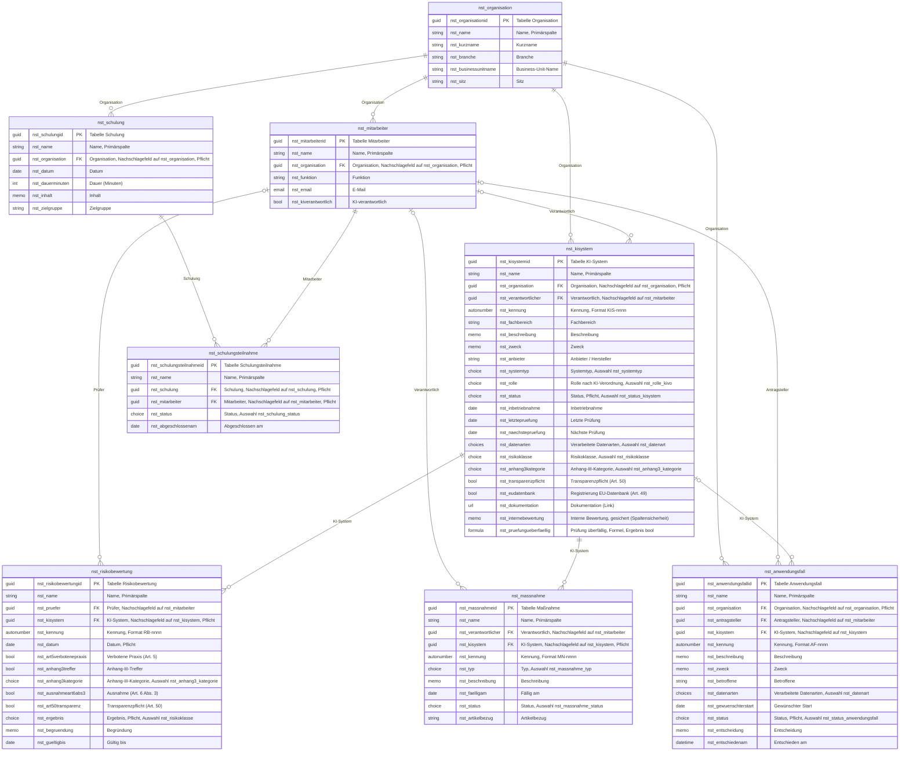

# Datenmodell des KI-Registers (ERD)

Dieses Dokument wird aus `provision/definitions/*.toml` erzeugt (`uv run python tools/erd.py`) und nicht von Hand geändert; `tests/unit/test_erd.py` schlägt fehl, wenn es vom Stand der Definitionen abweicht. Alle Daten sind fiktiv (Nordstern Gruppe), das Register ist keine Rechtsberatung.

## Diagramm

Lesehilfe: Die Entitäten tragen die Schemanamen der Tabellen, der Kommentar der Schlüsselzeile nennt den deutschen Anzeigenamen. `PK` ist der Primärschlüssel, `FK` ein Nachschlagefeld auf die Elterntabelle; die Beschriftung einer Linie ist der Anzeigename des Nachschlagefelds. `||` bedeutet genau ein Elternsatz (Pflichtfeld), `|o` null oder ein Elternsatz (optional), `o{` null bis viele Kindsätze. Spaltentypen: `string`, `memo` (langer Text), `int`, `bool`, `date`, `datetime`, `url`, `email`, `choice` und `choices` (Auswahl und Mehrfachauswahl eines globalen Auswahlfelds), `autonumber` (Zähler mit Präfix) und `formula` (berechnete Spalte).

Alle Tabellen sind benutzer- oder teameigen (`ownerid`); so bilden Unternehmenseinheiten Zugriffsgrenzen. Systemspalten wie Eigentümer, Erstellt am und Status sind nicht eingezeichnet.

## Tabellen

| Tabelle | Anzeigename | Mehrzahl | Primärspalte | Audit-Flag der Tabelle | Notizen |
| --- | --- | --- | --- | --- | --- |
| `nst_organisation` | Organisation | Organisationen | `nst_name` | nein | nein |
| `nst_mitarbeiter` | Mitarbeiter | Mitarbeiter | `nst_name` | nein | nein |
| `nst_kisystem` | KI-System | KI-Systeme | `nst_name` | ja | ja |
| `nst_anwendungsfall` | Anwendungsfall | Anwendungsfälle | `nst_name` | ja | ja |
| `nst_risikobewertung` | Risikobewertung | Risikobewertungen | `nst_name` | ja | ja |
| `nst_massnahme` | Maßnahme | Maßnahmen | `nst_name` | nein | nein |
| `nst_schulung` | Schulung | Schulungen | `nst_name` | nein | nein |
| `nst_schulungsteilnahme` | Schulungsteilnahme | Teilnahmen | `nst_name` | nein | nein |

## Beziehungen

| Beziehung | Eltern (1) | Kind (n) | Nachschlagefeld | Pflicht | Beim Löschen des Elternsatzes |
| --- | --- | --- | --- | --- | --- |
| `nst_organisation_mitarbeiter` | `nst_organisation` | `nst_mitarbeiter` | `nst_organisation` (Organisation) | ja | Verknüpfung entfernen |
| `nst_organisation_kisystem` | `nst_organisation` | `nst_kisystem` | `nst_organisation` (Organisation) | ja | Verknüpfung entfernen |
| `nst_organisation_anwendungsfall` | `nst_organisation` | `nst_anwendungsfall` | `nst_organisation` (Organisation) | ja | Verknüpfung entfernen |
| `nst_organisation_schulung` | `nst_organisation` | `nst_schulung` | `nst_organisation` (Organisation) | ja | Verknüpfung entfernen |
| `nst_mitarbeiter_kisystem_verantwortlicher` | `nst_mitarbeiter` | `nst_kisystem` | `nst_verantwortlicher` (Verantwortlich) | nein | Verknüpfung entfernen |
| `nst_mitarbeiter_anwendungsfall_antragsteller` | `nst_mitarbeiter` | `nst_anwendungsfall` | `nst_antragsteller` (Antragsteller) | nein | Verknüpfung entfernen |
| `nst_mitarbeiter_risikobewertung_pruefer` | `nst_mitarbeiter` | `nst_risikobewertung` | `nst_pruefer` (Prüfer) | nein | Verknüpfung entfernen |
| `nst_mitarbeiter_massnahme_verantwortlicher` | `nst_mitarbeiter` | `nst_massnahme` | `nst_verantwortlicher` (Verantwortlich) | nein | Verknüpfung entfernen |
| `nst_kisystem_risikobewertung` | `nst_kisystem` | `nst_risikobewertung` | `nst_kisystem` (KI-System) | ja | Löschen verhindern |
| `nst_kisystem_massnahme` | `nst_kisystem` | `nst_massnahme` | `nst_kisystem` (KI-System) | ja | Löschen verhindern |
| `nst_kisystem_anwendungsfall` | `nst_kisystem` | `nst_anwendungsfall` | `nst_kisystem` (KI-System) | nein | Verknüpfung entfernen |
| `nst_schulung_teilnahme` | `nst_schulung` | `nst_schulungsteilnahme` | `nst_schulung` (Schulung) | ja | Datensätze mitlöschen |
| `nst_mitarbeiter_teilnahme` | `nst_mitarbeiter` | `nst_schulungsteilnahme` | `nst_mitarbeiter` (Mitarbeiter) | ja | Löschen verhindern |

Dataverse erlaubt je untergeordneter Tabelle nur eine übergeordnete (kaskadierende) Beziehung. Deshalb ist Schulung die übergeordnete Tabelle der Schulungsteilnahme (Kaskade), und die Beziehung zum Mitarbeiter verhindert das Löschen (ADR-002).

## Auswahlfelder

Die Werte eines Auswahlfelds sind `580000000` plus die Position in der Reihenfolge der Definition (Optionswertpräfix 58000).

| Auswahlfeld | Anzeigename | Werte in Reihenfolge |
| --- | --- | --- |
| `nst_risikoklasse` | Risikoklasse | Nicht bewertet; Unannehmbar (Art. 5); Hoch; Begrenzt (Transparenzpflicht); Minimal |
| `nst_rolle_kivo` | Rolle nach KI-Verordnung | Anbieter; Betreiber; Einführer; Händler; Produkthersteller; Bevollmächtigter |
| `nst_systemtyp` | Systemtyp | Eigenentwicklung; Eingekaufte Standardsoftware; KI-Modell mit allgemeinem Verwendungszweck (GPAI); In Produkt eingebettet |
| `nst_status_kisystem` | Status KI-System | Idee; In Bewertung; Freigegeben; In Betrieb; Ausgesetzt; Eingestellt; Abgelehnt |
| `nst_status_anwendungsfall` | Status Anwendungsfall | Eingereicht; In Prüfung; Genehmigt; Abgelehnt; Zurückgezogen |
| `nst_anhang3_kategorie` | Anhang-III-Kategorie | Keine; 1 Biometrie; 2 Kritische Infrastruktur; 3 Bildung; 4 Beschäftigung; 5 Grundlegende Dienste; 6 Strafverfolgung; 7 Migration und Grenze; 8 Justiz und Demokratie |
| `nst_datenart` | Datenart | Personenbezogene Daten; Besondere Kategorien (Art. 9 DSGVO); Beschäftigtendaten; Patientendaten; Kundendaten; Betriebs- und Sensordaten; Keine personenbezogenen Daten |
| `nst_massnahme_typ` | Maßnahmentyp | Technisch; Organisatorisch; Dokumentation; Schulung; Vertraglich |
| `nst_massnahme_status` | Maßnahmenstatus | Offen; In Arbeit; Erledigt; Entfallen |
| `nst_schulung_status` | Schulungsstatus | Geplant; Abgeschlossen; Überfällig |
